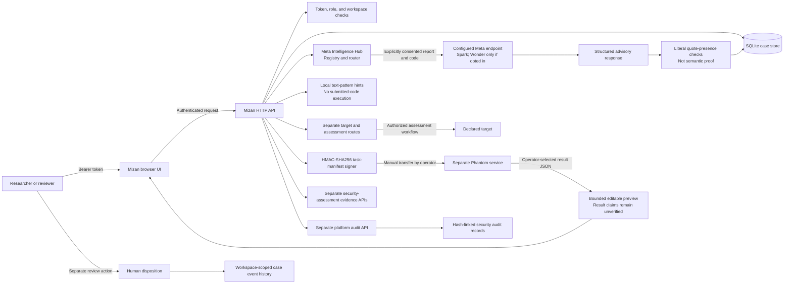

<div align="center">


# MIZAN

### Evidence-linked security triage. Human-owned decisions.

**Turn vulnerability reports into reviewable cases with explicit evidence, visible uncertainty, and a human-controlled outcome.**

[Watch the 3-minute demo](https://youtu.be/HWmw2o5sIv4) · [Run Mizan locally](#run-mizan-locally) · [Explore the API](docs/API.md)

[](https://github.com/aimenhamzi01-dot/mizan/actions/workflows/tests.yml)
[](https://www.python.org/)
[](LICENSE)

**Meta Global AI Developer Hackathon 2026**<br>
*Indie Developer Track · Build for Your World*

</div>

## The problem Mizan tackles

Security researchers and application-security teams spend time separating real vulnerability evidence from scanner noise, missing context, contradictory code, and untrusted report text. A fluent AI answer is not enough: reviewers need to see what the system relied on, what it could not establish, and who made the final decision.

Mizan is a self-hosted workbench for that review. It uses Meta model APIs for structured analysis when a researcher explicitly authorizes an external request, checks whether quoted excerpts literally occur in the supplied report or code, and keeps the model recommendation separate from a human disposition.

This is Mizan’s fit with **Build for Your World**: apply Meta models to a concrete workflow in cybersecurity, while making review and accountability part of the product rather than an afterthought. The hackathon theme and track are described on [Meta’s event page](https://dev.meta.ai/events/global-hackathon).

## See the product

The repository currently contains one product screenshot, showing an evidence trail and human-review area with synthetic example content. It illustrates exact-text matching—not proof that a vulnerability is true, exploitable, or fully understood.


The linked demo is the project walkthrough. The additional screen captures requested for a fuller gallery are listed in [Screenshot capture checklist](#screenshot-capture-checklist); no missing application screens have been fabricated.

## How a case moves through Mizan

1. A researcher saves a report and optional source snippet to a workspace. Saving is local and does not call a model.
2. For AI analysis, the researcher supplies their own authorized Meta API key, selects an enabled model, and explicitly confirms sending the report and source to the configured endpoint.
3. Mizan receives structured model output and checks whether each cited quote appears in the stated input. A missing or wrong-source quote is not accepted as verified evidence and can downgrade the recommendation to `need-info`.
4. A reviewer records a separate disposition—accept, reject, duplicate, or need information—with an optional note. Mizan does not submit a report, close a ticket, or send a reply on the reviewer’s behalf.

Mizan also includes separate target-assessment, findings, evidence, and platform-audit screens. Those are distinct from report triage; authorized assessment workflows can involve target-facing network activity. Do not interpret the offline report demo as evidence that every part of the broader platform is offline-only.

## What is different

- **Evidence is inspectable.** Mizan records the stated source, exact quote, offsets, number of matches, and ambiguity. This establishes literal presence in the submitted text only; a human still evaluates meaning, relevance, reachability, and exploitability.
- **Input boundaries are explicit.** Reports and source snippets are treated as untrusted data, separated from developer instructions, and are never executed by the report-triage path. These are safeguards, not a guarantee that a model can never be influenced by prompt injection.
- **Uncertainty stays visible.** Missing context, invalid output, contradictory excerpts, or failed quote checks can lead to `need-info` rather than an unsupported confident verdict.
- **The human owns the disposition.** A model suggestion and a reviewer’s authenticated decision are stored separately. The ordinary case history is an application event history, not the cryptographic audit chain described below.
- **Model routing is explicit.** The authenticated Meta Intelligence Hub exposes a 13-entry registry through `GET /api/models`. Only approved, enabled adapters are selectable; a request-level `model_id` is validated before model egress.
- **Local source checks are limited by design.** Mizan’s deterministic text-pattern hints inspect source already attached to a case; they do not import or execute it, fetch dependencies, or contact a target.

## Meta Intelligence Hub

Mizan uses the [Meta Model API](https://dev.meta.ai/docs/models) for structured, text-based security-triage calls. Muse Spark 1.3 is the default. Muse Spark 1.2 and 1.1 are also implemented. An explicit model selection is sent as that single model candidate; Mizan does not silently switch to a different model after an explicit selection. The default fallback order applies only when the request does not specify a model.

The table reflects **Mizan’s integration state**, not a guarantee that a particular API key or account can access a hosted model. The code and tests confirm request routing; no live provider call was made for this README review.

| Registry entry | Intended role in Mizan | Mizan status and configuration |
|---|---|---|
| `muse-spark-1.3` | Default text security-triage analysis | **Implemented.** Default model. Requires a researcher’s Meta API key and account access. |
| `muse-spark-1.2` | Selectable text security-triage analysis | **Implemented.** Requires a researcher’s Meta API key and account access. |
| `muse-spark-1.1` | Selectable text security-triage analysis | **Implemented.** Requires a researcher’s Meta API key and account access. |
| `muse-wonder-1.0` | Experimental text security-triage analysis | **Conditional.** Operator must set `MIZAN_ENABLED_MODELS=muse-wonder-1.0`; a user key with provider access is still required. Account access was not live-tested. |
| `muse-spark-1.3-contributor` | Contributor-mode Spark | **Not callable in Mizan.** Pending explicit data-use disclosure and policy review. |
| `muse-spark-1.2-contributor` | Contributor-mode Spark | **Not callable in Mizan.** Pending explicit data-use disclosure and policy review. |
| `muse-wonder-full` | Higher-capability Wonder variant | **Not callable in Mizan.** No Model API ID is verified in the registry; Meta documents Wonder Full for Muse Code, not Model API. |
| `muse-image-1.0` | Potential image-generation/editing workflow | **Registry-only.** Meta documents an image API, but Mizan has no image adapter or consent workflow. |
| `muse-voice-transcribe-1.0` | Potential audio intake/transcription | **Registry-only.** No Mizan audio upload, adapter, consent, or retention workflow. |
| `sam-3.1` | Potential visual-evidence segmentation | **Not callable in Mizan.** The registry has a local checkpoint entry; no Mizan hosted SAM adapter or local runtime is active. |
| `muse-glimmer-30b` | Potential local multimodal evaluation | **Open-weight entry; runtime pending.** No local inference adapter is active. |
| `muse-spark-open` | Potential local Muse Spark evaluation | **Open-weight entry; runtime pending.** Not a hosted Model API ID; no local inference adapter is active. |
| `llama-open-weight` | Potential local or third-party Llama evaluation | **Registry-only.** No specific hosted Meta API ID or local runtime adapter is configured. |

Meta’s documentation distinguishes standard and Contributor model modes; it says Contributor-mode content may be used to train future models. Mizan therefore keeps the two Contributor IDs disabled pending a deliberate data-mode review. For other non-Spark families, a registry row is not evidence that Mizan can call that interface. In particular, local-runtime environment values are informational only; Mizan does not send requests to a local model endpoint.

Meta also documents a hosted SAM 3.1 API. Mizan’s current registry entry is a local-checkpoint placeholder and has neither a hosted SAM adapter nor an active local runtime, so SAM is not callable through Mizan.

Model selection and enabled status are separate from provider access. A key is not tested when it is saved; the first explicitly confirmed model request is the provider check. Mizan records token usage only when returned and does not estimate dollar cost because a verified current price is not configured.

## Architecture and trust boundaries



Mizan does not automatically connect to Phantom. The manifest path, report-triage path, and separate target-assessment routes have different trust boundaries and should not be described as one automatic scan pipeline.

## Evidence, review, and audit

### Quote checks are not vulnerability proof

For report triage, the server checks whether each model-provided quote is present in the stated report or code value. It records the source, first matching offset, end offset, match count, and ambiguity. A text match does not show that the quote is relevant, complete, reachable, or sufficient to prove the security claim.

Mizan also contains a separate `EvidenceItem` engine for the broader assessment surface. Its SHA-256 digest is calculated over normalized evidence text, not the complete record or every provenance field. The Phantom preview route does not turn imported claims into verified `EvidenceItem` records.

### Human disposition is separate

Only an authorized reviewer or admin can record a disposition in the report workbench. The authenticated identity is supplied by Mizan’s authorization layer rather than trusted from a request label. A decision may be revised, and report-case events can be removed when a case is deleted. This history is useful for workflow context, but it is not tamper-proof.

The broader security-assessment surface has a separate hash-linked audit API with a chain-verification route. That platform audit log must not be conflated with the ordinary report-case event history.

## Phantom integration

Mizan prepares a short-lived task manifest and a researcher can transfer it manually to a separate Phantom operator. The manifest is signed with HMAC-SHA256 using `MIZAN_PHANTOM_SIGNING_KEY`; the same high-entropy secret must be provisioned privately for the receiving Phantom service. The signature protects the manifest’s integrity against parties without the shared key. It does **not** independently verify that the requester is legally authorized for a target; the authorization field is an attestation supplied by the requester.

A user can select a completed Phantom `ScanResult` JSON file in Mizan. Mizan maps an allowlisted subset into an editable draft. The user must inspect and separately save that draft as a local report. Mizan does not initiate a Phantom scan, fetch the target, or execute submitted code through this import path.

**Important trust limit:** Mizan’s import route does not verify a result signature or recompute a claimed source hash. Phantom’s findings, severity, excerpts, source hashes, and `verified` flag remain unverified claims in the draft; separately supplied researcher code is kept distinct. Any later Meta analysis still requires its own egress confirmation.

See the [Mizan–Phantom integration guide](docs/PHANTOM_INTEGRATION.md), [task schema](schemas/mizan-phantom-task-v1.schema.json), [result schema](schemas/phantom-scan-result-v1.schema.json), and [Phantom repository](https://github.com/aimenhamzi01-dot/phantom).

## Security and trust

Implemented controls include hashed bearer-token storage, role and workspace checks for report cases, AES-GCM encryption of researcher Meta API keys at rest, sanitized API errors, request bounds, and a loopback-only default deployment. The browser holds the personal access token in memory. Report/code egress to the configured Meta endpoint requires explicit confirmation; the optional second model pass requires separate confirmation because it sends the report, code, and first analysis again.

These controls have important limits:

- Report text, code, review notes, and application events are stored as plaintext in local SQLite. The host operator can access the database and environment file.
- Provider keys are encrypted at rest but are decrypted in the running process when used. The master key must be kept private and backed up with the database.
- The self-hosted app does not provide TLS termination, rate limiting, token expiry, MFA, or SSO. Do not expose it directly to the public internet; follow the [operations guide](docs/OPERATIONS.md) for private deployment.
- Prompt-injection defenses separate untrusted inputs from instructions, but cannot guarantee model behavior.
- Report triage does not run exploits or execute pasted source. Separate target-assessment workflows can contact targets when explicitly configured and run; users remain responsible for verified authorization and scope.
- A task signature verifies the signed manifest with the shared key; it does not prove authorization. Imported Phantom result JSON is not cryptographically authenticated by Mizan.

Review [SECURITY.md](SECURITY.md) and the [architecture and trust-boundary guide](docs/ARCHITECTURE.md) before using sensitive research data.

## Technical validation

The verified Mizan code commit [`1213eb7`](https://github.com/aimenhamzi01-dot/mizan/commit/1213eb79561255418f2c70de1667be918b508d62) passed the repository CI run on November 5, 2026: **179 unittest tests**, **179 pytest tests plus 21 subtests**, offline fixture evaluation, and the Docker Compose build and health smoke test. See the [GitHub Actions run](https://github.com/aimenhamzi01-dot/mizan/actions/runs/41948509669).

The offline evaluator checks six hand-labelled synthetic regression fixtures and makes zero model calls. The repository also includes a synthetic guardrail harness; its results are regression checks, not general model accuracy or security-performance scores. A separate local HTTP validation report records 45/45 checks on November 4, 2026, with zero Meta-provider calls and zero external-target calls ([report](docs/LIVE_TEST_REPORT.md), [runner](scripts/live_validation.py)).

These checks do not verify live Meta account access, Muse Wonder availability for a particular key, model accuracy on real reports, exploitability, latency, or production-scale security. No live Meta provider call was made for this review, and no accuracy or performance score is claimed. See the [evaluation protocol](docs/EVALUATION.md) for scope and limitations.

## Run Mizan locally

### Prerequisites

For the recommended one-command local setup, install **Python 3.9+**, **Docker Engine**, and the **Docker Compose v2** plugin. Without a Meta API key, you can sign in, inspect the registry, and load and save bundled synthetic examples locally. This no-key path does not generate a model recommendation; completing live analysis and the analyzed-case review flow requires an authorized key and explicit egress consent.

### Start the local application

```bash
git clone https://github.com/aimenhamzi01-dot/mizan.git
cd mizan
python3 scripts/run.py
```

The launcher creates a private `.env`, generates an installation-owner token, prints that token once, and starts the container. Save the token privately. Open [http://127.0.0.1:8000](http://127.0.0.1:8000) and sign in. The default bind is loopback.

### Python-only mode

If you do not want to use Docker, install the requirements and start the local server:

```bash
python3 -m pip install -r requirements.txt
python3 scripts/bootstrap.py
python3 server.py
```

### Enable live Meta analysis

A saved report remains local. To request live analysis, add an authorized personal Meta API key through the profile panel and explicitly confirm the egress prompt. Provider charges may apply. To opt the installation into experimental Muse Wonder 1.0, an operator must set `MIZAN_ENABLED_MODELS=muse-wonder-1.0` in the private environment; a user's key must still have provider access. Do not put keys in source files, public issues, screenshots, or shell history.

### Run tests and offline evaluation

```bash
python3 -m pip install -r requirements-dev.txt
python3 -m unittest discover -s tests -v
python3 -m pytest -q
python3 scripts/evaluate.py
```

`python3 scripts/evaluate.py` runs offline by default. Live evaluation is a separate opt-in, uses provider credentials, sends the selected synthetic cases, and may incur charges; read [Evaluation Protocol](docs/EVALUATION.md) before running it.

## Current gaps and possible next work

The following are not shipped capabilities or delivery promises; they are gaps visible in the current implementation:

- Finish and review Mizan adapters and consent flows for additional hosted modalities, and implement local runtime adapters only where deployment and license requirements are addressed.
- Add cryptographic verification and source binding for imported Phantom results; the present result route is a manual, unverified preview.
- Extend independently adjudicated evaluation beyond the small synthetic fixtures before making quality claims.
- Add real, redacted application captures for model selection and Phantom workflows to complete the screenshot gallery.

## Screenshot capture checklist

Only the existing evidence-trail preview above is currently used in this README. Capture any additional images directly from the running Mizan UI with synthetic or explicitly authorized data; never invent model output or display real tokens, API keys, private reports, or unredacted targets.

- [ ] Dashboard and case queue with a clearly labelled synthetic case.
- [ ] Saved vulnerability report with its model recommendation and missing-context fields; identify whether the result is live or synthetic.
- [ ] Evidence panel showing a literal quote match and the caveat that text matching does not prove the claim.
- [ ] Meta Intelligence Hub selector and registry statuses, including pending models and the opt-in state for Wonder.
- [ ] Phantom task-manifest screen with secrets and real targets redacted, plus the separate completed-result preview showing claims as unverified.
- [ ] Human disposition with authenticated role and ordinary case history; do not label that case history as the separate cryptographic platform audit chain.

## Project links

- [Architecture and trust boundaries](docs/ARCHITECTURE.md)
- [API reference](docs/API.md)
- [Evaluation protocol](docs/EVALUATION.md)
- [Judge demo instructions](docs/JUDGE_DEMO.md)
- [Operations guide](docs/OPERATIONS.md)
- [Mizan–Phantom integration](docs/PHANTOM_INTEGRATION.md)
- [Security policy](SECURITY.md)
- [Meta Model API model documentation](https://dev.meta.ai/docs/models)
- [Meta Global AI Developer Hackathon](https://dev.meta.ai/events/global-hackathon)
- [MIT License](LICENSE)

Contributions are welcome through focused issues and pull requests. Do not post private vulnerability reports, access tokens, customer data, or other sensitive research material in public contributions.

---

> **AI advises. Evidence proves. Humans decide.**
>
> In Mizan, “proves” means that a quoted string can be found in the supplied input; it does not establish semantic relevance or prove exploitability. The final security disposition remains with a human.
