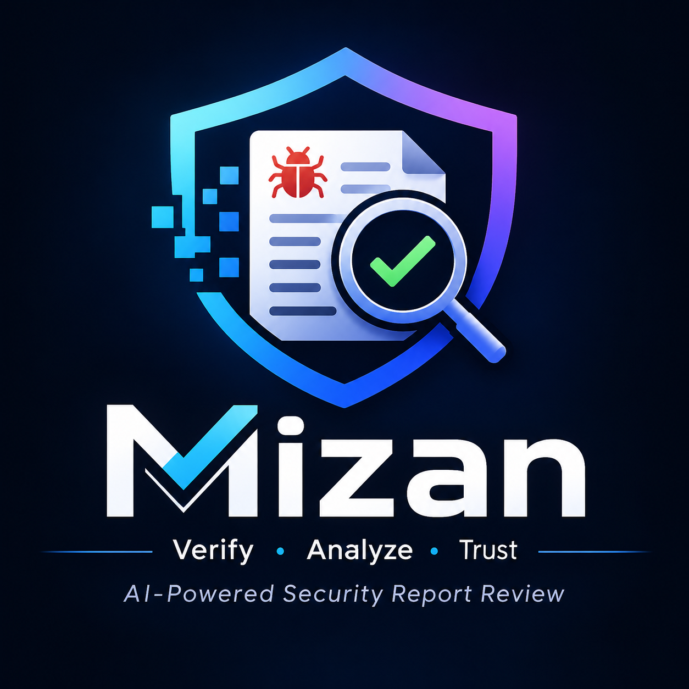
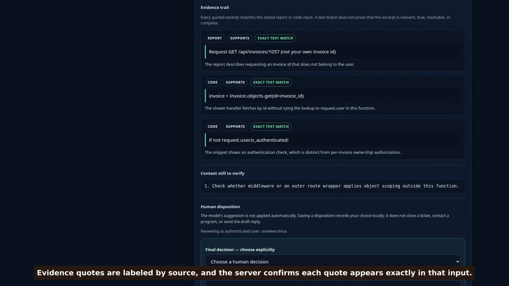
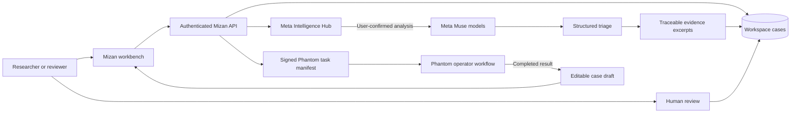

<div align="center">



# MIZAN

### Evidence-linked security triage. Human-led decisions.

**A self-hosted workbench that turns vulnerability reports into structured, evidence-linked cases for expert review.**

[Watch the 3-minute demo](https://youtu.be/HWmw2o5sIv4) · [Run Mizan locally](#run-mizan-locally) · [Explore the API](docs/API.md)

[](https://github.com/aimenhamzi01-dot/mizan/actions/workflows/tests.yml)
[](https://www.python.org/)
[](LICENSE)

**Meta Global AI Developer Hackathon 2026**<br>
*Indie Developer Track · Build for Your World*

</div>

## Build a clearer path from report to review

Security teams and vulnerability researchers work with reports that can be incomplete, noisy, or difficult to verify. Mizan brings the report, relevant code, AI-assisted analysis, evidence excerpts, and reviewer decision into one focused workflow.

Designed for the **Build for Your World** challenge, Mizan applies Meta’s Muse models to a practical cybersecurity use case: helping people organize and examine vulnerability evidence while keeping final judgments in human hands. See the [project demo](https://youtu.be/HWmw2o5sIv4) and Meta’s [hackathon overview](https://dev.meta.ai/events/global-hackathon).

## See Mizan in action



The [three-minute walkthrough](https://youtu.be/HWmw2o5sIv4) shows the workbench, model-assisted case analysis, traceable evidence excerpts, and a reviewer recording a decision.

## How it works

1. **Create a case.** Save a vulnerability report and optional source snippet in a workspace.
2. **Request AI assistance.** Choose an enabled Muse model and confirm the report and source may be sent to the configured Meta endpoint.
3. **Inspect traceable evidence.** Mizan associates each cited excerpt with its stated source and location, making it easy for a reviewer to examine the underlying text.
4. **Record a human decision.** An authorized reviewer records a disposition and optional note. The AI recommendation and human review remain distinct.

Saving a case is local; model analysis is a separate, explicit action. Mizan does not submit reports or close tickets on the reviewer’s behalf.

## Why Mizan

- **Evidence-linked analysis:** structured recommendations connect claims to excerpts from the report or supplied source.
- **Human-led outcomes:** reviewers choose and record the final case disposition.
- **Clear uncertainty:** missing context and evidence issues remain visible in the case review.
- **Purpose-built model routing:** select an enabled Muse Spark version for security triage.
- **Workspace-based review:** manage cases, roles, and review activity in a self-hosted environment.
- **Safe local source checks:** run bounded text-pattern checks on submitted source without executing it.
- **Extensible security workflow:** dedicated areas support target scope, assessment findings, evidence, evaluation, and platform audit.

## Meta Intelligence Hub

Mizan’s security-triage adapter supports these Meta-hosted text models:

| Model | Role in Mizan |
|---|---|
| `muse-spark-1.3` | Default model for structured security-triage analysis |
| `muse-spark-1.2` | Selectable Muse Spark version |
| `muse-spark-1.1` | Selectable Muse Spark version |
| `muse-wonder-1.0` | Experimental option, enabled by the installation operator |

Researchers use their authorized Meta API key. A selected model is routed explicitly for the request. Wonder can be enabled with `MIZAN_ENABLED_MODELS=muse-wonder-1.0`; the user’s account must also have provider access. See the [Meta Model API documentation](https://dev.meta.ai/docs/models) and the [API guide](docs/API.md).

## Phantom handoff

Mizan complements [Phantom](https://github.com/aimenhamzi01-dot/phantom) with a signed task-manifest workflow for operator-led, authorized testing. Researchers can transfer a manifest to a Phantom operator, then load a completed Phantom result into Mizan as an editable case draft for review.

This handoff keeps case review in Mizan while allowing Phantom to operate as a separate scanning service. See the [Mizan–Phantom integration guide](docs/PHANTOM_INTEGRATION.md).

## Architecture at a glance



## Privacy and security

Mizan is self-hosted and provides authenticated, workspace-scoped access, role-based review, encrypted storage for personal Meta API keys, and explicit confirmation before report content is sent for model analysis. Submitted report text and source are treated as input data, not executable code. Read the [security policy](SECURITY.md) and [operations guide](docs/OPERATIONS.md) for deployment guidance.

## Validation

The project’s automated checks cover unit and API behavior, model routing, evidence handling, reviewer workflow, and the local container. The current main-branch CI passed **179 unittest tests**, **179 pytest tests plus 21 subtests**, offline fixture evaluation, and a Docker Compose health check. The offline evaluator uses synthetic regression examples and makes no model calls.

See the [evaluation protocol](docs/EVALUATION.md), [live local validation report](docs/LIVE_TEST_REPORT.md), and [GitHub Actions](https://github.com/aimenhamzi01-dot/mizan/actions).

## Run Mizan locally

### Requirements

Install **Python 3.9+**, **Docker Engine**, and the **Docker Compose v2** plugin. Synthetic examples can be explored locally. Live model analysis uses the researcher’s authorized Meta API key.

### Start

```bash
git clone https://github.com/aimenhamzi01-dot/mizan.git
cd mizan
python3 scripts/run.py
```

The launcher prepares a private local configuration and starts the application. Save the one-time installation-owner token it displays, then open [http://127.0.0.1:8000](http://127.0.0.1:8000).

For Python-only mode:

```bash
python3 -m pip install -r requirements.txt
python3 scripts/bootstrap.py
python3 server.py
```

To run the tests and offline evaluator:

```bash
python3 -m pip install -r requirements-dev.txt
python3 -m unittest discover -s tests -v
python3 -m pytest -q
python3 scripts/evaluate.py
```

## Project resources

- [Architecture](docs/ARCHITECTURE.md)
- [API reference](docs/API.md)
- [Evaluation protocol](docs/EVALUATION.md)
- [Judge demo instructions](docs/JUDGE_DEMO.md)
- [Operations guide](docs/OPERATIONS.md)
- [Mizan–Phantom integration](docs/PHANTOM_INTEGRATION.md)
- [Security policy](SECURITY.md)
- [MIT License](LICENSE)

---

> **AI assists. Evidence is traceable. Humans decide.**
