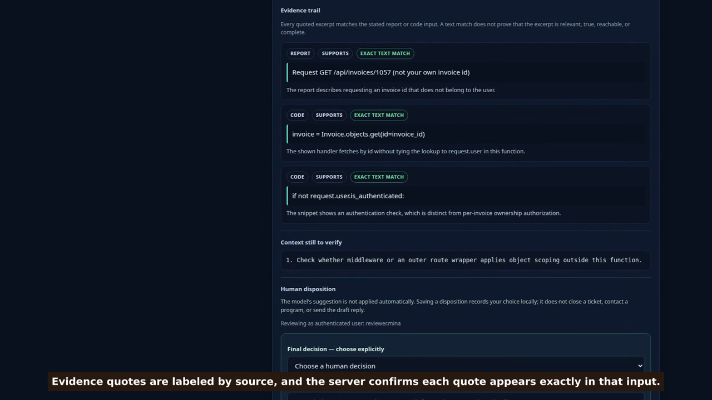

<div align="center">

# Mizan

### Evidence-led security triage. Human judgment stays in control.

A self-hosted workbench that helps security researchers review vulnerability reports, inspect source-linked evidence, and record a human decision—without executing submitted code or contacting reported targets.

[](https://github.com/aimenhamzi01-dot/mizan/actions/workflows/tests.yml)
[](LICENSE)
[](https://dev.meta.ai/docs/models)

**Built for the [Meta Global AI Developer Hackathon 2026](https://dev.meta.ai/events/global-hackathon)** · Indie Developer Track · *Build for Your World*

<a href="https://youtu.be/RT6BPgxCHZ4"></a>

[▶ Watch the submitted demo](https://youtu.be/RT6BPgxCHZ4) · [Download the 60-second MP4](assets/Mizan-Hackathon-Demo.mp4) · [Explore the source](https://github.com/aimenhamzi01-dot/mizan)

</div>

## The problem Mizan takes on

Security teams spend time sorting actionable vulnerability reports from scanner output, incomplete claims, and AI-generated noise. Reports can also contain prompt-injection text aimed at manipulating an AI reviewer. Mizan gives researchers a structured place to assess those reports while keeping the model advisory and the final disposition explicitly human-owned.

## A quick judge walkthrough

You can explore the workbench without a Meta API key or a model call:

1. Start the local installation using the [quick-start steps](#run-mizan-locally).
2. Sign in with the installation-owner token printed during first-run setup.
3. Load the built-in **IDOR evidence trail** example. The case is synthetic; loading it stays local and does not send it to Meta.
4. Inspect the report and code excerpts, the server-verified text matches, and the context still requiring review.
5. See how a reviewer records a disposition separately from the model's suggestion.

Live Muse Spark analysis is optional. It requires a researcher's own Meta API key and an explicit confirmation before case content is sent to the configured endpoint.

## What makes Mizan different

- **Evidence that can be checked.** The model returns report or code excerpts with source labels. Mizan checks each quote against the stated input and calculates its location and occurrence count so a reviewer can return to the original text.
- **Human decision, not auto-triage.** The model's proposed outcome is kept separate from the reviewer's recorded disposition. Recommendations do not close reports or trigger external actions.
- **A deliberate second look.** An optional challenge pass asks the model to surface concrete contradictions, assumptions, or missing context. It requires separate consent and is an additional model call—not independent verification.
- **A safer analysis boundary.** Report and code are treated as untrusted data. Mizan does not execute submitted code, exploit vulnerabilities, or contact a target.
- **Research-team control.** Mizan is self-hosted, supports workspace-scoped roles, and lets each researcher use their own encrypted-at-rest Meta API key and pay for their own model usage.

## How Mizan uses Meta models

Mizan sends a report and optional pasted code to the configured Meta-compatible Model API only after an explicit user action and server-side egress confirmation. Muse Spark returns structured analysis, including the claim, possible injection attempts, code assessment, evidence excerpts, a suggested severity and disposition, and a draft reply. The configured model order defaults to `muse-spark-1.3` with `muse-spark-1.1` as fallback.

The server checks the literal presence of each quoted excerpt before presenting it as verified. A failed citation check downgrades the suggestion to `need-info`. This check confirms text presence only—it does not prove that the quote is relevant, complete, true, or sufficient to establish exploitability. The optional challenge pass uses the same configured model endpoint, so it must not be described as an independent judge.

## Run Mizan locally

**Requirements:** Docker Engine and Docker Compose v2. Python-only operation is also available; see [Python setup](#python-only-setup).

```bash
git clone https://github.com/aimenhamzi01-dot/mizan.git
cd mizan
python3 scripts/run.py
```

On first run, the bootstrap creates a private `.env`, prints the installation-owner token once, and starts the app. Open <http://127.0.0.1:8000> and sign in with that token. The owner can create workspaces and issue individual researcher tokens from **Workspace administration**.

The app binds to loopback by default. `docker compose down` preserves the database volume; `docker compose down -v` deletes it. Do not share the owner token: it grants global administrative access.

### Python-only setup

```bash
python3 -m pip install -r requirements.txt
python3 scripts/bootstrap.py
python3 server.py
```

Python mode also binds to loopback by default and stores data at `data/mizan.sqlite3`. Do not bind it to an untrusted network.

## Workflow at a glance

1. **Receive:** Save a report and optional code locally. Saving a case does not call a model.
2. **Analyze:** A researcher confirms whether the selected case may be sent to the configured Meta endpoint.
3. **Inspect:** Review the model's structured assessment, source-labelled excerpts, citation matches, and missing context.
4. **Challenge (optional):** Authorize a second model request to look for specific weaknesses in the first assessment.
5. **Decide:** A human reviewer records or revises the disposition. The audit trail identifies the authenticated actor.

## Workspaces and roles

| Role | Scope and capabilities |
|---|---|
| Installation owner | Global administration; create workspaces and manage all users |
| Workspace admin | Manage members and issue analyst, reviewer, or viewer tokens within one workspace |
| Analyst | Read workspace cases, submit reports, and request analysis |
| Reviewer | Read cases and record or revise human dispositions |
| Viewer | Read workspace cases only |

Case visibility is workspace-scoped, not per-case ownership. Workspace admins cannot create other workspace admins or create workspaces. The owner token is the only global identity.

## Privacy, cost, and safety boundaries

- Reports, code snippets, analyses, and review history are stored in local SQLite. **The database itself is not encrypted.** Protect the host, volume, backups, and `.env` file.
- Each researcher's Meta API key is encrypted at rest with AES-GCM. The installation encryption key remains in `.env`; back it up securely with the database.
- Each researcher supplies and pays for their own Meta API usage. An optional `MODEL_API_KEY` fallback is limited to the installation owner.
- Live analysis sends the selected report and code to `META_API_BASE` only after explicit consent. The optional challenge sends case content again and may incur additional charges.
- Mizan does not execute submitted code, perform exploits, or contact reported targets.
- Exact quote matching proves only that the quoted characters occur in the stated source. Model assessments remain advisory and require human review.

Mizan is a self-hosted prototype, not a vulnerability validator or a production SaaS. It does not provide database encryption, automatic token expiry, MFA, automatic retention, or TLS termination. Review [SECURITY.md](SECURITY.md) and the [operations guide](docs/OPERATIONS.md) before enabling team access.

## Evaluation and tests

Run the offline checks locally:

```bash
python -m unittest discover -s tests -v
python scripts/evaluate.py
```

The evaluation command validates a small bundled set of synthetic English and Arabic cases and makes **zero model calls by default**. An explicitly authorized live run can send only those synthetic fixtures and may incur API charges. The harness reports regression metrics; it is not evidence of production accuracy. GitHub Actions runs the offline test suite, builds the container, and smoke-tests its health and authenticated API paths.

## Technical map

| Component | Responsibility |
|---|---|
| `server.py` | HTTP API, authentication, workspace RBAC, and explicit egress controls |
| `triage.py`, `prompts.py` | Model workflow, untrusted-input boundary, normalization, and evidence checks |
| `meta_client.py` | Meta-compatible Model API client and response metadata |
| `auth_store.py`, `secret_store.py` | Workspace identities, token digests, and encrypted personal model keys |
| `review_store.py` | SQLite migrations, workspace-scoped reports, audit events, and metrics |
| `static/index.html` | Researcher workbench and administration interface |
| `scripts/bootstrap.py`, `scripts/run.py` | Private first-run setup and Docker startup |
| `scripts/evaluate.py`, `tests/fixtures/` | Offline fixture validation and opt-in synthetic evaluation |
| `Dockerfile`, `compose.yaml`, `tests/` | Container setup and regression coverage |

## Further reading

- [Architecture](docs/ARCHITECTURE.md)
- [API reference](docs/API.md)
- [Evaluation protocol](docs/EVALUATION.md)
- [Operations guide](docs/OPERATIONS.md)
- [Security policy and limitations](SECURITY.md)
- [MIT License](LICENSE)
