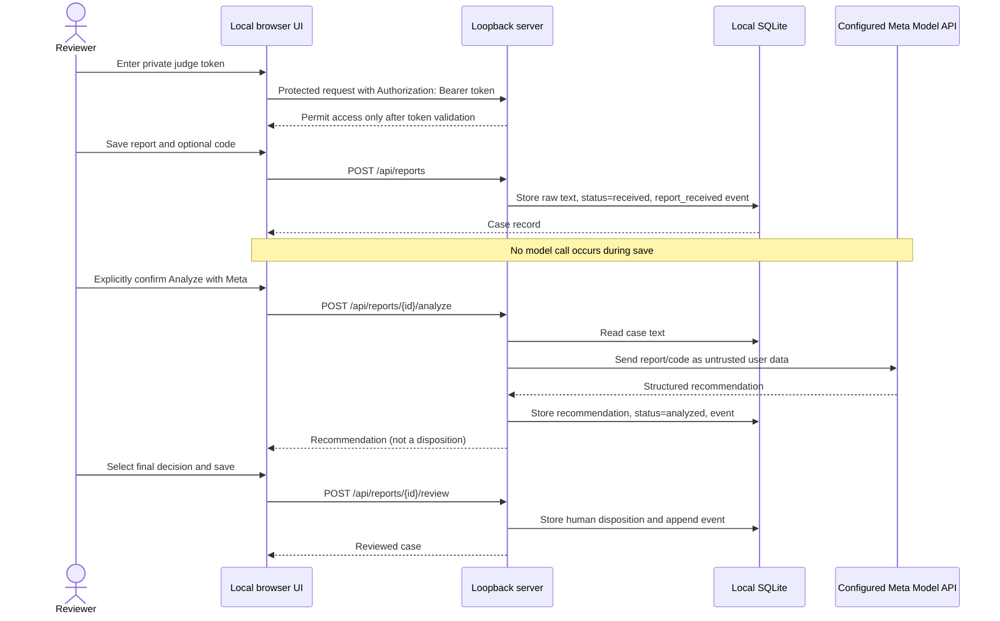
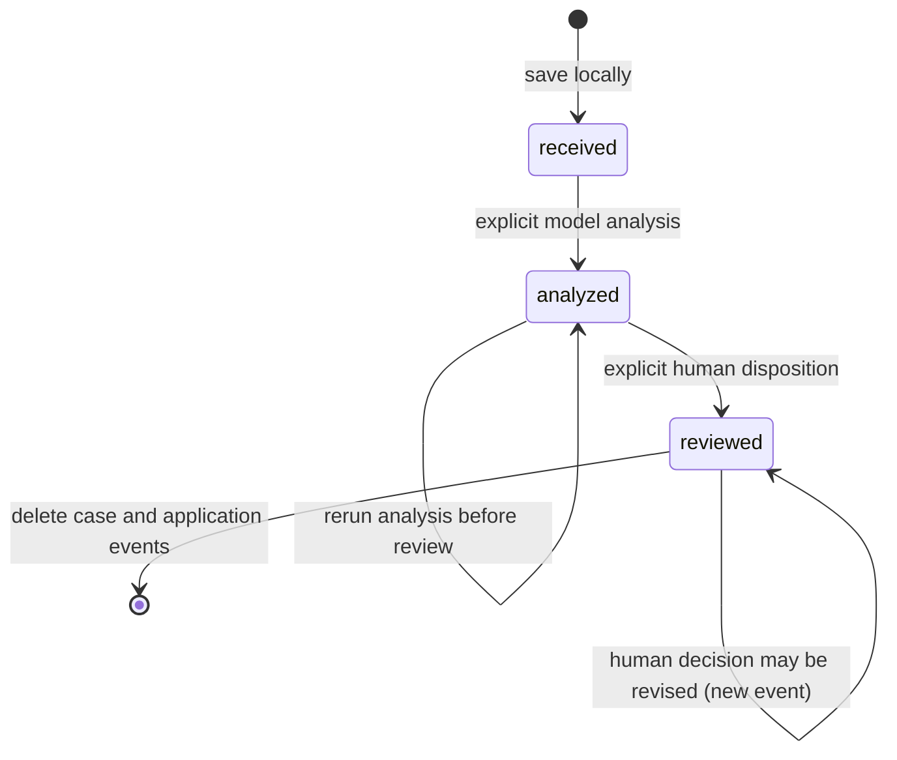

# Architecture and Trust Boundaries

## Purpose

Mizan is a local-first workbench for triaging vulnerability reports. It organizes untrusted report text, optionally asks a configured Meta Model API for an advisory analysis, and records a separate human disposition. It does not validate a live target or automate disclosure.

## Components

- **Browser UI (`static/index.html`)** — token-entry gate, intake form, local case queue, case detail, explicit model-egress confirmation, review form, and deletion control. The token exists in browser memory only and is sent in an Authorization header. Untrusted fields are inserted through DOM text nodes, not interpreted as HTML. It loads no remote fonts or scripts.
- **HTTP server (`server.py`)** — standard-library loopback server. It requires a configured Bearer token on every `/api/*` route, checks local `Host`/`Origin`, validates JSON bodies and request-size limits, routes reads/writes, and returns sanitized errors. Authentication is a shared-token gate, not per-user authorization or production deployment hardening. It never routes a report to a target.
- **Triage layer (`triage.py`, `prompts.py`)** — makes a single model request after explicit analysis action, keeps system and user roles separate, JSON-quotes report/code text with one-pass template substitution, extracts structured output, and normalizes enum values and decision constraints.
- **Model client (`meta_client.py`)** — sends the model messages to the configured Meta-compatible Chat Completions endpoint with environment-based credentials. It is the only outbound network path in live mode. A custom `META_API_BASE` is trusted operator configuration; never point it at a target or an untrusted endpoint.
- **Local store (`review_store.py`)** — stores cases and application-level events in SQLite. SQL values use parameters. The default directory and database have restrictive owner permissions on POSIX systems; database content is not encrypted.

## Data flow

The sequence intentionally contains no target-system component. The only external service is the configured model endpoint, invoked only through the analysis action after the UI confirmation and `confirm_egress: true` API field.

## Case state machine

The model's `suggested_decision` and a reviewer's `review_decision` are different database fields. Analysis never sets `review_decision`. A reviewed case cannot be re-analyzed; create a separate case if a fresh analysis is required.

## Trust boundaries

1. **Browser input is untrusted.** Report/code are length-limited text. They are never parsed as executable files. Stored values are rendered as text, not HTML.
2. **Model output is untrusted.** The normalizer restricts the response schema and enums. It does not make the model authoritative or verify unprovided route/middleware context.
3. **Local persistence is sensitive plaintext.** A case may contain private vulnerability details. The database file is not encrypted; local backups/copies are outside Mizan's deletion control.
4. **The HTTP API is single-user local-only.** All API routes require a 32-byte-minimum shared Bearer token and the server checks expected local hosts/origins. The token grants full access to all cases and is not per-reviewer identity, roles, or individual revocation. This is not a safe public network service.
5. **Operator configuration is trusted.** `MIZAN_JUDGE_TOKEN`, `MODEL_API_KEY`, and `META_API_BASE` are process/environment settings, never report fields. The base URL receives the model bearer key and case contents in live analysis; use only a trusted authorized endpoint.

## Non-goals

- Exploit execution, dynamic scanning, proof-of-concept replay, or target connectivity.
- Automatic acceptance/rejection, ticket closure, disclosure, or reporter communication.
- Multi-user hosting, internet deployment, encrypted storage, or regulated-data compliance.
