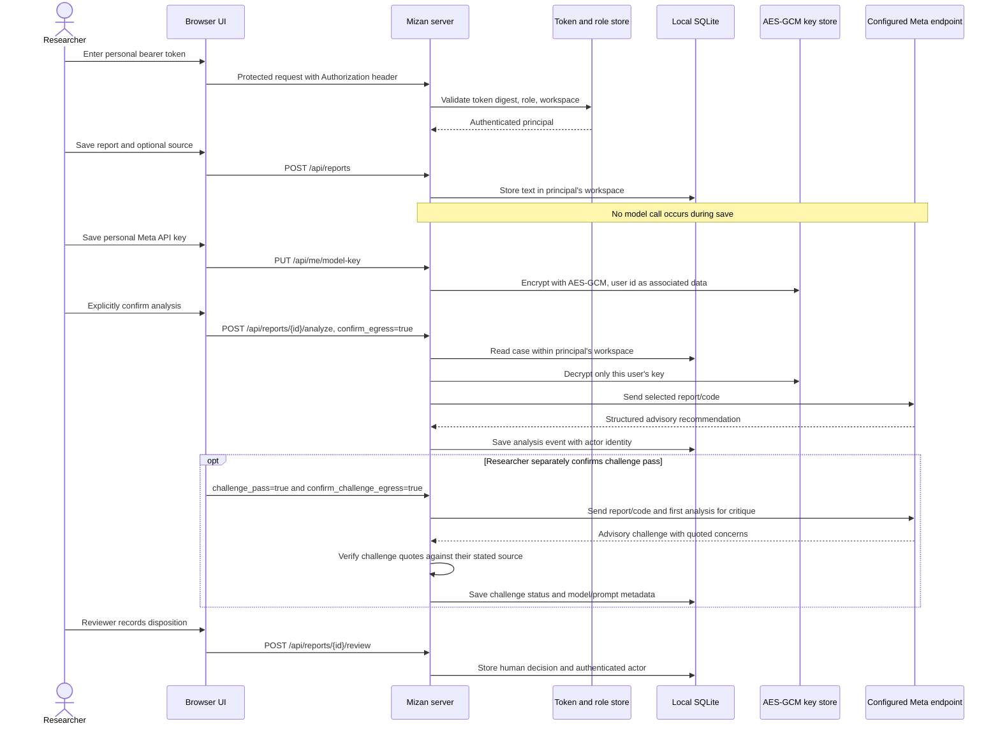
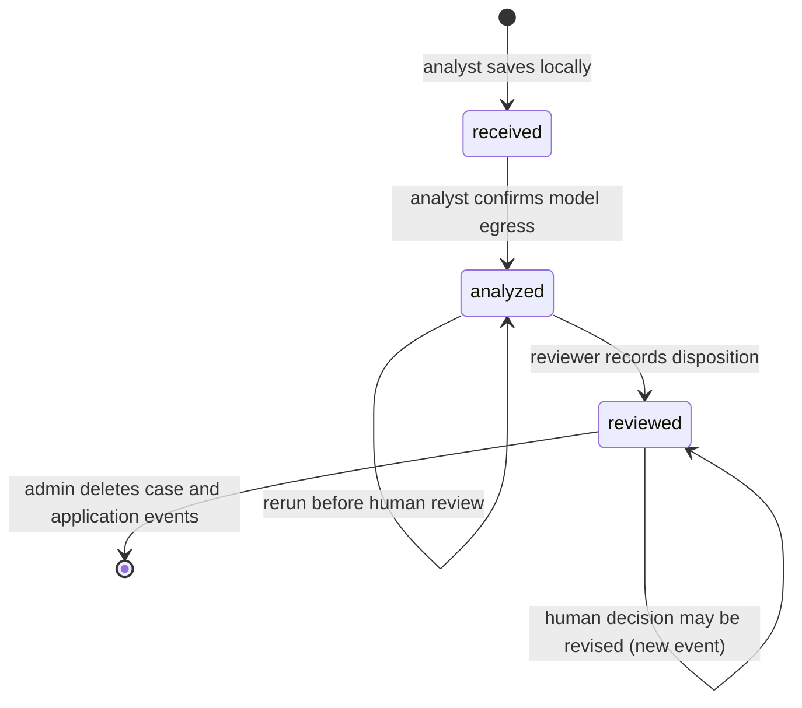

# Architecture and Trust Boundaries

## Purpose

Mizan is a self-hosted, human-led security-report triage workbench. A single operator-controlled installation can serve multiple private research workspaces. Each user has an individual token and role; every ordinary case query is scoped to the user's workspace. Researchers provide their own Meta API keys and are responsible for their own provider usage.

## Components

- **Browser UI (`static/index.html`)** — personal-token gate, workspace case queue, profile for the researcher's provider key, explicit model-egress confirmation, source-linked evidence highlights, an optional separately confirmed challenge pass, human review, and workspace-member administration. The bearer token is held in memory only. Values are rendered as DOM text, not interpreted as HTML.
- **HTTP server (`server.py`)** — validates local or explicitly allow-listed Host/Origin; authenticates the installation-owner token or an individual token; enforces role checks and workspace scope on every route; validates request sizes and JSON; and returns sanitized errors. It does not trust `X-Forwarded-*` headers.
- **Identity store (`auth_store.py`)** — creates workspaces, users, high-entropy tokens, role assignments, revocation, and token rotation. SQLite stores only SHA-256 token digests; bearer tokens are returned once.
- **Case store (`review_store.py`)** — versioned SQLite schema. Each report maps to one workspace. Existing records migrate into `default`. Event history records authenticated actor ids and names. Queries for non-owner principals include workspace scope.
- **Secret store (`secret_store.py`)** — encrypts each user's Meta API key with AES-256-GCM and user-id associated data. The master 32-byte key is supplied through private `MIZAN_ENCRYPTION_KEY`, never through the browser.
- **Triage (`triage.py`, `prompts.py`)** — issues the primary model call only after explicit user action and server confirmation. User report/code remain separate from system instructions, are JSON-quoted, and are normalized through hard acceptance guardrails. The optional challenge is a second advisory model pass requiring separate confirmation; its source quotations are also checked server-side.
- **Model client (`meta_client.py`)** — sends messages to the configured Meta-compatible endpoint using the authenticated user's key and can return allowlisted model/token-usage metadata. Only the installation owner may use the legacy environment-key fallback.
- **Container (`Dockerfile`, `compose.yaml`)** — runs non-root with a read-only root filesystem, dropped capabilities, persistent SQLite volume, and a loopback-only host port by default.
- **Bootstrap (`scripts/bootstrap.py`)** — creates a private owner token, AES encryption key, and unique Compose project name. It never prints the encryption key and refuses to silently replace a previously initialized missing key.

## Authentication and workspace boundaries

The installation-owner token is an operator secret granting global access. Other users are created by the owner or a scoped workspace admin and receive individual high-entropy tokens. Tokens are stored as SHA-256 hashes because they contain 256 bits of random entropy. A user may be revoked or have their token rotated; the old token then fails immediately. Tokens have no automatic expiry and there is no password/MFA/SSO login.

The server derives identity and workspace from the bearer token; request-body workspace, username, or reviewer labels do not override it. Analysts can create/analyze cases. Reviewers can record human dispositions. Viewers can read. Workspace admins manage workspace members but cannot create another admin or workspace. The owner can administer all workspaces.

All users within one workspace share visibility of its cases. The app does not implement per-case ownership. Out-of-scope case ids return 404 to avoid revealing whether another workspace contains them.

## Data flow

No target-system component exists. The only application egress is the configured model endpoint, and it occurs only after explicit confirmation.

For each verified quote, the server computes the first source offset, end offset, and occurrence count. The UI can jump to and highlight the first match; repeated excerpts are visibly marked ambiguous. This establishes literal presence only, not semantic relevance or truth. Prompt hashes identify instruction-template versions without storing prompt contents in metadata. The optional second pass uses the same configured endpoint and is not independent verification; a concern, inconclusive result, or invalid challenge citation downgrades the model suggestion to `need-info`, never the human disposition.

## Case state machine

`analysis.suggested_decision` and `review_decision` are separate. Model analysis never becomes a final disposition. A reviewed case cannot be re-analyzed; create a new case if a fresh analysis is required.

## Storage and migrations

Schema version 2 adds workspaces, users, token digests, report-to-workspace mappings, encrypted personal API keys, and actor ids in the event table. Existing reports are assigned to `default` during migration. Case text and event details remain plaintext; only provider API keys are encrypted. The installation key must be backed up with the database. Losing it prevents decryption of saved provider keys.

## Trust boundaries and limitations

1. **Browser input is untrusted.** Reports and code are length-limited text; they are never imported or executed.
2. **The token determines identity.** Request-supplied workspace ids are ignored for ordinary users; audit actor identities come from authentication, not client text.
3. **The workspace is the sharing boundary.** All members in a workspace can read all cases there. The installation owner can read all workspaces. The host operator can access SQLite and `.env`.
4. **Report storage is plaintext.** Backups, host access, and volume permissions require operator controls.
5. **Provider keys are encrypted at rest, not in use.** The process decrypts a user's key to call the provider. An attacker with process access or both the DB and master key can recover keys.
6. **The model endpoint is an external recipient.** `META_API_BASE` receives the bearer key and selected report/code during explicit analysis.
7. **Network protections are limited.** Default bind is loopback. Private remote access requires a TLS proxy, exact allow-lists, and network controls. Mizan itself has no TLS termination, rate limiting, token expiry, SSO, or MFA.
8. **AI output remains advisory.** The model cannot infer omitted route decorators, middleware, or deployment context. Humans remain responsible for dispositions.

## Non-goals

Mizan does not execute exploits, validate external targets, automatically close tickets, contact programs/reporters, provide centralized SaaS hosting, or make compliance/security certification claims.
