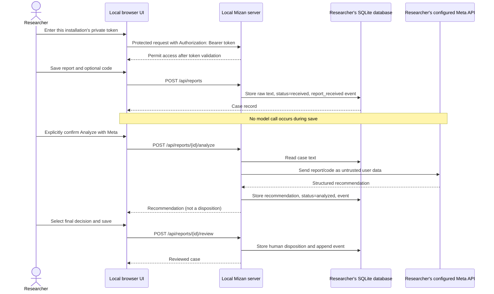
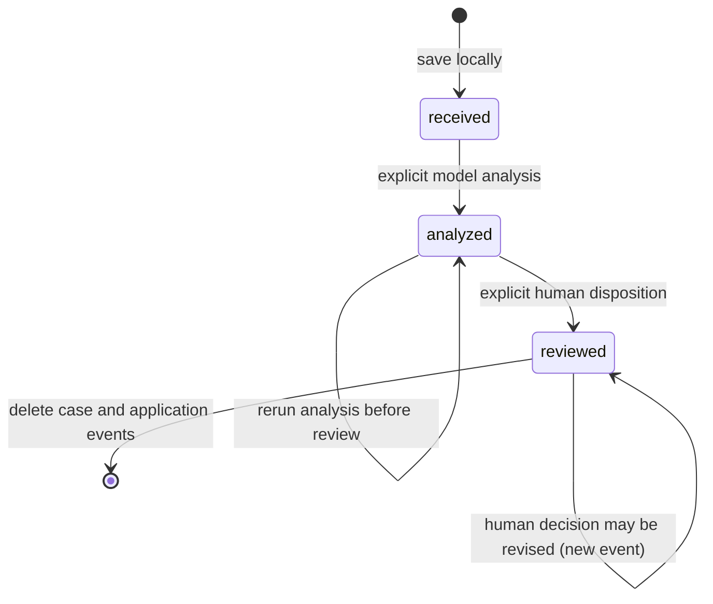

# Architecture and Trust Boundaries

## Purpose

Mizan is a self-hosted, single-researcher workbench for triaging vulnerability reports. Each researcher runs an independent local instance, configures their own Meta API key, and owns their SQLite data. The project does not provide a central public service or shared provider account.

## Components

- **Browser UI (`static/index.html`)** — token-entry gate, intake form, local case queue, case detail, explicit model-egress confirmation, review form, and deletion control. The per-install token exists in browser memory only and is sent in an Authorization header. Untrusted fields are inserted through DOM text nodes, not interpreted as HTML. It loads no remote fonts or scripts.
- **HTTP server (`server.py`)** — standard-library server. It defaults to loopback, requires the per-install Bearer token on every `/api/*` route, checks local `Host`/`Origin`, validates JSON bodies and request-size limits, and returns sanitized errors. The `/healthz` route exposes only a minimal readiness boolean. Docker Compose binds the container port to host loopback.
- **Triage layer (`triage.py`, `prompts.py`)** — makes a single model request after explicit analysis action, keeps system and user roles separate, JSON-quotes report/code text with one-pass template substitution, extracts structured output, and normalizes enum values and decision constraints.
- **Model client (`meta_client.py`)** — sends model messages to the configured Meta-compatible Chat Completions endpoint using the researcher-owned key from local environment configuration. It is the only outbound network path in live mode. A custom `META_API_BASE` is trusted operator configuration; never point it at a target or an untrusted endpoint.
- **Local store (`review_store.py`)** — stores cases and application-level events in SQLite. SQL values use parameters. The default Python directory/database have restrictive owner permissions on POSIX systems; the database is plaintext and not encrypted.
- **Container (`Dockerfile`, `compose.yaml`)** — runs as a non-root user with a read-only root filesystem, dropped capabilities, a private persistent volume, and a host port bound to `127.0.0.1` only.
- **Bootstrap (`scripts/bootstrap.py`)** — creates a private `.env` file and generates a random access token for a fresh local installation. It never modifies `.env.example` or adds secrets to Git.

## Data flow

The sequence intentionally contains no target-system component. The only outbound application path is the configured model endpoint, invoked only after explicit user confirmation and `confirm_egress: true`. Each researcher configures and pays for their own provider key.

## Case state machine

The model's `suggested_decision` and a reviewer's `review_decision` are different database fields. Analysis never sets `review_decision`. A reviewed case cannot be re-analyzed; create a separate case if a fresh analysis is required.

## Trust boundaries

1. **Browser input is untrusted.** Report/code are length-limited text. They are never parsed as executable files. Stored values are rendered as text, not HTML.
2. **Model output is untrusted.** The normalizer restricts the response schema and enums. It does not make the model authoritative or verify unprovided route/middleware context.
3. **Local persistence is sensitive plaintext.** A case may contain private vulnerability details. SQLite is not encrypted; local backups and copies remain the researcher's responsibility.
4. **The API is single-install, not multi-tenant.** A per-install shared token grants full access to that install's cases. It is not a public account system or a safe mechanism for sharing one server among untrusted researchers.
5. **Docker exposure is restricted by default.** Compose publishes to `127.0.0.1`, although the process listens on `0.0.0.0` inside the container. Widening the host mapping or adding a public proxy requires a new security design.
6. **Operator configuration is trusted.** `MIZAN_JUDGE_TOKEN`, `MODEL_API_KEY`, and `META_API_BASE` are local process/environment settings, never report fields. The base URL receives the model bearer key and case contents in live analysis.

## Non-goals

- Exploit execution, dynamic scanning, proof-of-concept replay, or target connectivity.
- Automatic acceptance/rejection, ticket closure, disclosure, or reporter communication.
- Central multi-user hosting, shared provider billing, encrypted storage, or regulated-data compliance.
